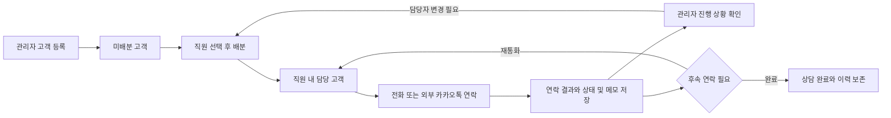
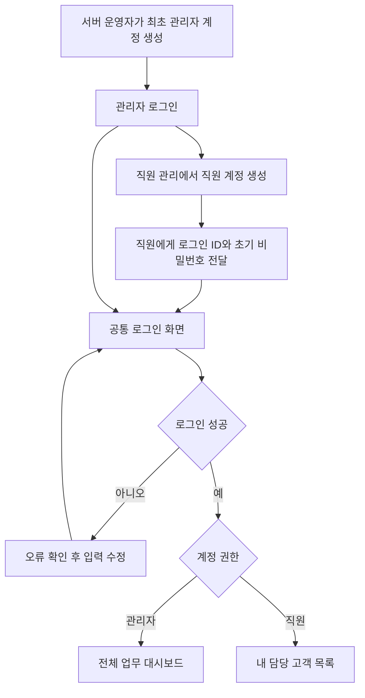
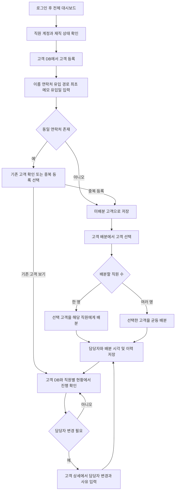
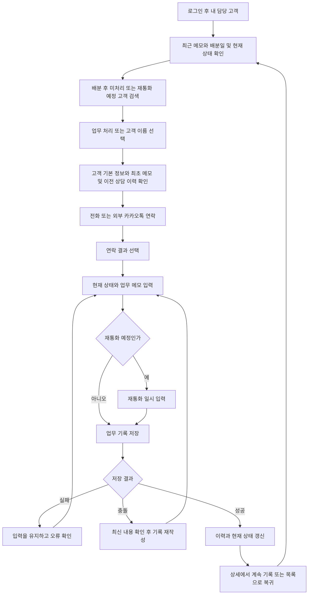

# LeadFlow 역할별 업무 흐름

관리자가 고객을 등록하고 직원에게 배분하면, 직원은 자기 담당 고객에게 연락하고 결과를 기록한다. 관리자는 전체 고객의 상태와 직원별 진행 상황을 확인한다. 이 문서는 현재 구현을 기준으로 로그인부터 배분, 상담, 재배분까지의 화면과 처리 기준을 설명한다.

## 전체 흐름



## 역할과 권한

| 업무                               | 관리자              | 직원                      |
| ---------------------------------- | ------------------- | ------------------------- |
| 고객 조회                          | 전체 고객           | 현재 본인에게 배분된 고객 |
| 고객 기본 정보 등록과 수정 및 삭제 | 가능                | 불가                      |
| 직원 계정 생성과 비밀번호 재설정   | 가능                | 분실 시 관리자에게 요청   |
| 고객 배분과 재배분                 | 가능                | 불가                      |
| 상담 내용과 고객 상태 기록         | 전체 고객           | 본인 담당 고객            |
| 진행 상황 확인                     | 전체 및 직원별 현황 | 본인 담당 고객 현황       |

‘하위 관리자’는 이 문서에서 **직원**을 뜻한다. 직원에게 다른 직원의 고객을 배분하거나 계정을 관리하는 권한은 없다. API가 매 요청마다 현재 담당자와 계정 상태를 검사한다.

## 계정 준비와 공통 로그인



개발 환경의 공통 주소는 **http://localhost:5173**이다. http://localhost:5174 에서도 같은 역할 기반 화면이 열린다. 로그인 전에 고객 상세 주소로 접근했다면 로그인 후 접근 가능한 원래 주소로 돌아간다. 직원이 관리자 전용 주소에서 로그인하면 내 담당 고객으로 이동한다.

최초 관리자 계정은 서버 운영자가 다음 명령으로 만든다. 비밀번호는 안내에 따라 12자 이상으로 두 번 입력하며, 입력 내용은 화면에 표시되지 않는다. 기본 비밀번호나 공개 회원가입은 없다.

```sh
cd apps/api
uv run python -m app.cli bootstrap-admin --login-id admin --name 관리자
```

직원 비밀번호를 잊으면 관리자가 **직원 관리 → 계정 관리 → 새 비밀번호**에서 재설정하고 직원에게 안전한 경로로 전달한다. 기존 세션은 종료된다. 관리자 비밀번호 분실 시 서버 운영자가 아래 명령으로 재설정한다. 이 명령은 활성 관리자 계정만 대상으로 하며 비활성 계정을 재활성화하지 않는다.

```sh
cd apps/api
uv run python -m app.cli reset-admin-password --login-id admin
```

## 관리자 흐름



1. **직원 준비:** 로그인 ID·이름·초기 비밀번호로 계정을 생성한다. 배분 대상은 재직 중인 직원이다.
2. **고객 등록:** 이름·연락처는 필수다. 담당자를 선택하면 등록과 배분을 한 번에 저장하며, 나중에 배분할 수도 있다. `등록 후 계속 추가`는 담당자·유입 경로를 유지하고 이름·연락처·최초 메모를 비워 다음 고객을 입력한다.
3. **고객 선택:** 미배분 목록 또는 고객 DB 목록에서 체크박스로 선택한다. 한 페이지는 15건이며 페이지를 이동해도 최대 500명까지 선택을 유지한다. 전체 선택 체크박스는 현재 페이지만 선택·해제하며, 검색 조건 또는 메뉴를 바꾸면 선택을 초기화한다.
4. **배분:** 직원의 현재 담당·미처리 고객 수를 확인하고 선택한다. 한 명을 선택하면 수동 일괄 배분, 여러 명이면 선택 순서대로 균등 배분하며 직원별 이번 배분 건수를 미리 보여준다. 기존 보유 고객 수는 균등 계산에 포함하지 않는다.
5. **모니터링:** 담당자·상담 상태·유입 경로·유입 기간·배분 여부·배분 후 미처리 여부로 고객을 찾고 상세 이력을 확인한다.
6. **재배분:** 담당자를 변경하고 사유를 남긴다. 기존 상담 상태·재통화 일정·최초 메모·상담 이력은 보존된다. 이전 담당자는 즉시 조회와 기록 권한을 잃는다.

## 직원 흐름



직원 목록에는 이름·연락처·현재 상태·유입 경로·최근 상담 메모·현재 담당자 배분일·최근 활동 시각이 표시된다. 최근 메모는 가장 최근의 비어 있지 않은 업무 메모이며, 최초 유입 메모와 구분한다.

업무 처리 화면은 새로고침과 직접 링크를 지원하는 **고객 상세 페이지**다. 데스크톱에서는 상담 입력과 이전 이력을 나란히, 작은 화면에서는 전체 폭의 한 열로 표시한다. 별도의 모달은 사용하지 않는다. 원 기획의 ‘기존 기록을 확인하며 업무를 저장한다’는 동작은 같은 화면에서 제공한다.

**업무 기록 저장**은 상세 화면을 유지하며 새 이력을 보여준다. **저장 후 목록으로**는 저장 성공 후 원래 목록의 검색 조건과 페이지로 돌아간다. 미처리 필터를 적용했다면 처리한 고객은 해당 목록에서 빠진다. 단순히 상세를 열어보는 것은 처리 완료로 간주하지 않는다.

## 상태와 업무 기록 구분

| 구분           | 의미                                                        | 예시                                                                                   |
| -------------- | ----------------------------------------------------------- | -------------------------------------------------------------------------------------- |
| 현재 상태      | 고객의 상담 진행 단계                                       | 신규, 연락 진행 중, 재통화 예정, 상담 진행 중, 보류, 거절, 상담 완료                   |
| 업무 기록      | 직원이 실제로 한 행동과 내용                                | 전화 시도, 전화 부재, 전화 연결, 카카오톡 전달 기록, 상담 진행, 메모                   |
| 배분 후 미처리 | 현재 담당자가 이번 배분 이후 아직 업무 기록을 저장하지 않음 | 상담 진행 중인 고객을 다른 직원에게 재배분하면 상담 상태는 유지하고 미처리 표시를 추가 |

예를 들어 전화로 내일 다시 연락해 달라는 요청을 받으면 **전화 연결 → 재통화 예정 → 내일 14시 → 요청 내용 메모**를 한 번에 저장한다. 상태 변경과 활동 이력은 같은 DB 트랜잭션으로 반영된다.

현재 담당자가 이번 배분 이후 업무 기록을 저장하면 ‘배분 후 미처리’ 표시가 해제된다. 관리자의 추가 메모는 직원의 처리로 계산하지 않는다. 이는 ‘읽음’ 상태나 상담 완료 여부를 뜻하지 않는다.

카카오톡은 외부에서 보낸 내용을 직원이 수동 기록하는 기능이다. 실제 전송 버튼이나 전송 성공 보장은 제공하지 않는다. 전화번호 링크는 기기의 전화 앱 연결에 사용한다.

## 날짜와 실패 처리

| 항목               | 기준                                                       |
| ------------------ | ---------------------------------------------------------- |
| 유입일             | 고객이 문의한 시각. 등록 시 입력 가능하며 기간 검색에 사용 |
| 시스템 등록일      | 관리자가 시스템에 고객을 생성한 시각                       |
| 현재 담당자 배분일 | 가장 최근에 현재 담당자에게 배분한 시각                    |
| 재통화 일시        | 직원이 기록한 다음 연락 예정 시각                          |
| 저장과 표시        | UTC로 저장하고 한국 시간으로 표시                          |

저장 실패 시 입력을 유지하고 오류를 표시한다. 충돌이 있으면 최신 정보를 확인한 뒤 다시 작성하며 자동으로 재시도하지 않는다. 저장 중 중복 제출을 막고, 저장하지 않은 입력이 있는 상태에서 이동하면 확인한다. 비활성·퇴사 직원은 기존 세션을 포함해 차단하고 과거 작성자와 이력은 보존한다.

## 후속 범위

Excel/CSV 업로드·다운로드, 재통화 알림, 실제 전화 발신 API, 카카오 실제 발송 API는 아직 구현하지 않았다. 균등 배분에 기존 보유량을 반영하는 기능과 초대 링크를 통한 직원의 최초 비밀번호 설정은 아직 구현하지 않았다.

## 역할별 추가 업무 경로

| 역할        | 시작 화면                                                    | 다음 화면과 완료 동작                                                                       |
| ----------- | ------------------------------------------------------------ | ------------------------------------------------------------------------------------------- |
| 관리자      | 직원 관리의 업무 상세 / 담당 고객 수 또는 대시보드 업무 상세 | 직원 업무 상세 → 상태·미처리 필터 → 고객 상세 → 원래 목록 복귀. 계정 관리로도 이동 가능     |
| 관리자·직원 | 재통화 일정                                                  | 오늘·기한 초과·내일 이후·전체 → 고객 상담 → 저장 후 원래 일정 목록 복귀                     |
| 관리자·직원 | 고객의 업무 기록 또는 전체 타임라인                          | 기록 상세·정정 → 원본 확인 → 사유와 현재 상태 확인 → 새 정정·취소 이력 저장 → 타임라인 확인 |
| 관리자·직원 | 내 계정 설정                                                 | 현재 비밀번호 확인 → 연락처 저장 또는 새 비밀번호 설정 → 비밀번호 변경 시 재로그인          |

직원의 재통화 일정과 기록 상세 접근 범위는 API에서 현재 담당자로 제한한다. 관리자가 만든 메모는 직원의 배분 후 미처리를 해제하지 않는다. 기한 초과는 현재 시각 이전이며 오늘 목록과 겹칠 수 있다. 자동 알림은 제공하지 않는다.

## 업무 흐름 개선

- 직원 등록에서 초기 비밀번호 자동 생성·표시를 지원한다. 등록 완료 후 접속 주소와 로그인 ID 안내를 복사하고 고객 배분으로 이동할 수 있다. 안내에 비밀번호를 포함하지 않으며 저장 후 입력한 비밀번호는 화면 상태에서 지운다.
- 신규 고객의 담당자 지정은 고객 생성과 배분 이력을 같은 트랜잭션으로 저장한다. 비활성 계정 등으로 배분에 실패하면 고객도 생성하지 않는다. 미배분 고객 상세는 `담당자 지정`을 제공한다.
- 직원 고객 목록에서 오늘 재통화·기한 초과·배분 후 미처리 목록으로 바로 이동한다.
- 상담 입력은 기본적으로 메모 작성이다. 전화 결과·상담 진행을 선택하면 신규 또는 연락 진행 상태에 맞는 상태를 제안한다. 직원이 직접 선택한 상태와 기존 재통화·보류·거절·완료 상태는 자동 변경하지 않는다. `다시 연락하기`, `상담 완료로 기록`은 사용자가 명시적으로 결과를 선택하는 동작이다. 재통화 일시는 1시간 후·내일 오전 10시로 빠르게 입력할 수 있다.
- 직원의 `저장하고 다음 고객`은 저장 전에 현재 목록의 필터와 정렬 기준으로 다음 고객을 조회한다. 저장이 성공한 경우에만 이동하며, 다음 고객이 없으면 저장 완료와 목록의 마지막임을 안내한다. 다음 고객 조회나 저장 실패 시 입력을 유지하고 자동 재시도하지 않는다.
